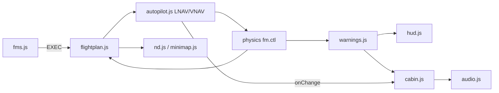

# FMS (Uçuş Planı + LNAV/VNAV) ve Kabin/Kokpit Sesleri — Tasarım

Tarih: 2026-11-20 · Durum: Onaylandı (sohbet içinde, 3 bölüm)

## 1. Amaç ve kapsam

Kullanıcı istekleri:
1. Uçuş sırasında **uçuş planı hazırlama** — ileri seviye: rota + otopilotla yatay (LNAV) ve dikey (VNAV) profil takibi.
2. **Ses kısma/açma** — mute'a ek olarak kademeli ses seviyesi.
3. **Durumsal uçak sesleri** — buluta girişte kemer ikazı "dın-dın", 10.000 ft / kabin hazırlık zilleri, A/P-A/T ayrılma ve irtifa yaklaşma tonları, stall / overspeed / alçak irtifa ikazları.

Varsayımlar ve kısıtlar:
- Sesler projedeki mevcut yaklaşımla **WebAudio ile prosedürel** üretilir; ses dosyası eklenmez.
- Yeni npm bağımlılığı eklenmez. Testler Node 22 yerleşik `node:test` ile.
- Uçuş planı yalnızca gerçek dünya modunda (`world.frame` varken) kullanılabilir.

Kapsam dışı: SID/STAR, navaid/airway veritabanı, yakıt/ağırlık hesabı, holding pattern, uzun rotalarda arazi ön yükleme.

## 2. Modüller

| Dosya | Tür | Sorumluluk |
|---|---|---|
| `src/flightplan.js` | yeni, saf | Plan verisi (lat/lon), büyük daire mesafe/yön, cross-track, fly-by geçişi, TOD, irtifa kısıtları, VNAV faz/hedef hesabı. three.js/DOM bağımlılığı yok. |
| `src/fms.js` | yeni, DOM | FMS/MCDU penceresi: RTE / LEGS / PERF sekmeleri, MOD → `EXEC` akışı, `localStorage` kalıcılığı. |
| `src/warnings.js` | yeni, saf | HUD'daki uyarı koşullarının ortak tek kaynağı: `computeWarnings(state)` → `[{id, text, level}]`. |
| `src/cabin.js` | yeni | Kabin/kokpit ses tetikleyicileri (histerezis, cooldown, "bir kez" mantığı, öncelik). Ses motorunu enjekte alır (test için mock). |
| `src/volume.js` | yeni, DOM | 🔊 ses paneli: master + 3 kanal sürgüsü. |
| `src/audio.js` | değişir | Kanal grupları (motor/çevre, uyarılar, sesli bildirim), seviye API'si, yeni sentez sesleri, speech volume'un seviyeye bağlanması. |
| `src/autopilot.js` | değişir | `LNAV` yatay modu, `VNAV` dikey modu, FAF'ta `APP` otomatik arm; `fma` güncellemesi. |
| `src/mcp.js` | değişir | `LNAV`, `VNAV`, `FMS` butonları ve tooltip'leri. |
| `src/nd.js` | değişir | Magenta rota, aktif WPT, TOD işareti, sonraki WPT / mesafe / ETA, "OFF ROUTE". |
| `src/minimap.js` | değişir | Rota polyline'ı (aktif: düz, MOD: kesik), WPT etiketleri, haritaya tıklayarak WPT ekleme (FMS açıkken). |
| `src/hud.js` | değişir | Uyarıları `warnings.js`'ten alır; FMA'da LNAV/VNAV. |
| `src/main.js` | değişir | Bağlantılar, kısayollar, döngü güncellemesi. |

## 3. Uçuş planı ve FMS

### Veri modeli (`flightplan.js`)
```js
plan = {
  origin: { icao, rwIndex, end } | null,
  dest:   { icao, rwIndex, end } | null,
  wpts:   [{ id, lat, lon, alt: null | { type: 'AT'|'AOA'|'AOB', ft } }],
  crzFt: 35000, clbKt: 280, crzMach: 0.78, desKt: 280,
}
```
Varış pist ucundan uzatılmış merkez hattı üzerinde **FAF = eşikten 10 NM**, irtifa = pist eşiği + 10 NM · tan 3°. Rota sırası: başlangıç → wpts → FAF → eşik.

Fonksiyonlar (saf):
- `gcDistance(a, b)` (NM), `gcBearing(a, b)`, `crossTrack(pos, a, b)` (NM, sağ +), `alongTrack(pos, a, b)`.
- `legs(plan, airports)` → bacak listesi `{from, to, crs, distNm}`.
- `turnAnticipationNm(gsKt, courseChangeDeg)` — 25° yatışla dönüş yarıçapı üzerinden fly-by mesafesi.
- `todDistanceNm(crzFt, fafFt)` = (crzFt − fafFt) / tan 3° → NM.
- `vnavTarget(state)` → `{ phase: 'CLB'|'CRZ'|'DES'|'APP', altFt, spdKt }` (kısıtlar, 10.000 ft altında ≤ 250 kt).
- `validate(plan, airports)` → hata listesi (bilinmeyen ICAO, bozuk koordinat, irtifa sınırı).

### FMS penceresi (`fms.js`)
- **Açma:** `Tab` tuşu veya MCP'deki `FMS` butonu. `F` gaz azaltma tuşu olduğu için kullanılmıyor. Pencere sürüklenebilir (`Layout`).
- **RTE sekmesi:** Kalkış varsayılanı mevcut havalimanı/pist. Varış havalimanı ICAO, IATA veya ad ile aranır (mevcut menüdeki normalize arama), ardından pist ucu seçilir.
- **LEGS sekmesi:** WPT listesi. Ekleme yolları: (a) FMS açıkken büyük mini haritaya tıklamak, (b) `lat,lon` yazmak, (c) havalimanı ICAO kodu yazmak. Sil / ↑ / ↓ ile düzenlenir. Her satırda bacak yönü, mesafesi ve irtifa kısıtı alanı (`AT 9000`, `A9000` = at or above, `B9000` = at or below) bulunur.
- **PERF sekmesi:** CRZ ALT (varsayılan FL350, en fazla 41.000 ft), CLB/DES IAS, CRZ Mach, toplam mesafe, ETE, TOD konumu.
- **MOD → EXEC:** Düzenlemeler taslakta (MOD) tutulur; haritada kesik çizgiyle görünür. `EXEC` ile aktif olur. Hatalı planda `EXEC` pasiftir ve hatalar kırmızı satır içinde gösterilir.
- **Kalıcılık:** Aktif plan `localStorage['skyview.fpl']` altında saklanır. Bozuksa yok sayılır.

### LNAV
- Hedef track = bacak yönü + cross-track düzeltmesi (`clamp(-xtk · k, ±30°)`), mevcut HDG döngüsünden geçer (yatış ≤ 25°).
- Kalan mesafe ≤ fly-by mesafesi olduğunda sonraki bacağa geçilir (`WPT SEQ`).
- FAF bacağına girilince `appArmed` / `gsArmed` otomatik `true` olur. `ap.runway` varış eşiğine ayarlanır ve mevcut LOC/G/S/FLARE/autoland devralır.
- Rotadan 5 NM'den fazla sapmada `OFF ROUTE` gösterilir, LNAV armed kalır.
- MCP'de `HDG SEL` seçmek LNAV'ı bırakır.

### VNAV
- **CLB:** FLCH mantığı (tırmanma gücü, hız burunla), hedef = `min(sonraki kısıt, crzFt)`, hız `clbKt` (10.000 ft altında ≤ 250).
- **CRZ:** ALT HOLD + A/T, hız = `crzMach`'tan IAS'e çevrilmiş değer.
- **DES:** TOD'a gelindiğinde (kalan rota mesafesi ≤ TOD mesafesi) 3° patikayı hedefleyen V/S; hız `desKt`, 10.000 ft altında 250 kt. Kısıtlara uyulur.
- **APP:** G/S yakalanınca VNAV, mevcut G/S moduna devreder.
- MCP'de ALT HLD veya V/S seçmek VNAV'ı bırakır.

### Görselleştirme
- **ND:** Magenta rota çizgileri, WPT üçgenleri ve kimlikleri, aktif WPT vurgusu, `T/D` işareti; sağ üstte `WPT  DIST  ETA`.
- **Mini harita:** Aynı rota (aktif düz, MOD kesik), WPT etiketleri, T/D.

## 4. Ses kontrolü

- **Kanallar:** `engine` (motor, rüzgâr, yuvarlanma, yağmur, gök gürültüsü), `alerts` (chime, C-chord, wailer, shaker, clacker, mekanik sesler), `voice` (callout'lar ve GPWS konuşmaları, `SpeechSynthesis.volume` ile). Hepsi `master` seviyesine bağlıdır.
- **API:** `setVolume(ch, 0..1)`, `getVolume(ch)`, `toggleMute()`.
- **Arayüz (`volume.js`):** 🔊 butonu (sürüklenebilir). Tıklayınca master + 3 kanal sürgüsü açılır.
- **Kısayollar:** `M` mute, `,` / `.` master −/+ %10. HUD mesajı: `SES %70` / `SES KAPALI`.
- **Kalıcılık:** `localStorage['skyview.audio']`.

## 5. Durumsal sesler (`cabin.js` + `audio.js`)

| Olay | Ses | Koşul / tekrar önleme |
|---|---|---|
| Buluta giriş / türbülans | Kemer chime'ı (iki ton "dın-dın") | `inCloud` 0.3'ü yukarı geçince veya türbülans orta seviyeye ulaşınca; cooldown 90 s |
| Kalkış hazırlığı | Çift chime + "Cabin crew, prepare for take-off" | Yerde, park freni kapalı, gaz > %60; uçuş başına bir kez |
| İniş hazırlığı | Çift chime + "Cabin crew, prepare for landing" | Alçalırken 10.000 ft altı ve takım açıkken; uçuş başına bir kez |
| 10.000 ft geçişi | Tek chime | Tırmanış ve alçalışta, ±200 ft histerezis |
| İrtifa yaklaşma | C-chord | Hedef irtifaya (MCP veya VNAV) 900 ft kala; her hedef değeri için bir kez |
| A/P ayrılma | Wailer (2 s) | `ap` true → false; A/P tekrar basılınca susar |
| A/T ayrılma | Kısa kesikli ton | `at` true → false |
| Stall | Stick shaker sesi + kamera sarsıntısı | `fm.stall > 0.05` ve havada |
| Overspeed | Clacker | `ias > vfe + 4` veya `mach > 0.82` |
| GPWS | "SINK RATE", "PULL UP", "TOO LOW, GEAR", "BANK ANGLE" | `warnings.js` koşulları; her biri ~3 s'de bir tekrar eder |
| Takım / flap | Hidrolik uğultu + "tak" / flap motoru | `G`, `X` ve `Z` komutları |

Öncelik: PULL UP > STALL > OVERSPEED > SINK RATE / TOO LOW / BANK ANGLE > chime'lar. Aynı anda tek bir `voice` uyarısı konuşur.

`warnings.js` koşulları (HUD'daki mevcut mantık taşınır):
- STALL: `stall > 0.05 && !onGround`
- OVERSPEED: `ias > vfe + 4 || mach > 0.82`
- PULL UP: `!onGround && ra < 2000 && vs < -2500 && ra / -vs < 0.33`
- SINK RATE (yeni): `!onGround && ra < 2500 && vs < -2000 && !PULL UP`
- TOO LOW GEAR: `!onGround && ra < 800 && !gearDown && throttle < 0.3`
- BANK ANGLE: `|bank| > 40°`
- TAIL STRIKE ve CONFIG: PARKING BRAKE yalnızca görsel uyarı olarak kalır.

## 6. Veri akışı



Plan lat/lon olarak tutulur. Yerel x/z'ye dönüşüm `world.frame.toLocal` ile `EXEC` anında bir kez yapılır ve bacaklarda önbelleğe alınır.

## 7. Hata ve kenar durumları

- Geçersiz giriş → FMS'te kırmızı satır içi hata, `EXEC` pasif.
- Plan yokken LNAV/VNAV → `NO ROUTE` mesajı, mod devreye girmez.
- Uçuşta aktif bacak silinirse en yakın sonraki bacak aktif olur.
- Hayali dünya → FMS butonu gri, tooltip nedeni açıklar; `Tab` "FMS: gerçek dünya modunda kullanılabilir" mesajı verir.
- AudioContext henüz başlamadıysa ilk tıklamada başlar; `speechSynthesis` yoksa sesli bildirimler atlanır.
- Bozuk `localStorage` → varsayılanlara dönülür.

## 8. Dünya kapsamı (planlama sırasında bulunan kısıtlar)

- **Arazi kapsamı:** `RealTerrain` yalnızca başlangıcın ±160 km çevresinde kök karo kuruyor. `EXEC` anında rota boyunca eksik zoom-8 kök karoları eklenir (`terrain.ensureCoverage(lat, lon)`). Rota uzunluğu en fazla **800 km** (validate hatası).
- **Varış pisti:** Pist kurma döngüsü `world.addAirport(airport)` olarak ayrılır (async: önce DEM, sonra düzleştirme bölgesi ve pist mesh'i). Bölgede önceden kurulmuş karolar `terrain.refreshArea(x, z, r)` ile yeniden üretilir. Fonksiyon her pist ucu için yerel `{x, z, elev, heading}` döndürür; bu değerler APP için `ap.runway` olarak kullanılır.
- **Bulutlar:** Kümeler uçağın etrafında 70 km periyotla toroidal sarılır. Küme ve puf'ları ±70 km kaydırılır. Cirrus ve deck katmanları kamerayı x/z'de takip eder, doku ofseti dünyaya sabit kalır.
- **Hesaplama düzlemi:** Rota takibi (LNAV/VNAV) `world.frame.toLocal` ile yerel x/z düzleminde yapılır; fizik ve araziyle birebir tutarlıdır. Lat/lon büyük daire fonksiyonları yalnızca FMS gösterimi ve doğrulama için kullanılır.
- **Yaklaşma hızı:** Son bacakta (FAF → pist) VNAV hızı `180 × speedScale` kt olur; G/S yakalanınca `145 × speedScale` kt (Vapp). Flap ve takım pilota bırakılır; HUD'da `FLAPS / GEAR` hatırlatması gösterilir.
- **Plan geri yükleme:** `localStorage`'daki plan açılışta **MOD (taslak)** olarak yüklenir; `EXEC` gerekir, çünkü başlangıç yeri farklı olabilir.

## 9. Test

- **Birim (`node --test tests/`):**
  - `flightplan.js`: mesafe, yön, xtk, fly-by, TOD, kısıtlar, VNAV fazları, validate.
  - `warnings.js`: tüm eşikler.
  - `cabin.js`: histerezis, cooldown, bir-kez davranışı, öncelik (mock ses motoruyla).
- **Tarayıcı:** LTFM → LTBA kısa rotası. Kontrol edilecekler: LNAV takibi, WPT SEQ, CLB → CRZ → T/D → APP geçişi, ND/haritada rota, buluta girişte chime, ses sürgüleri. Konsolda hata olmamalı.
- **Docker:** `docker compose up -d --build` → HTTP 200 ve `healthy`.
